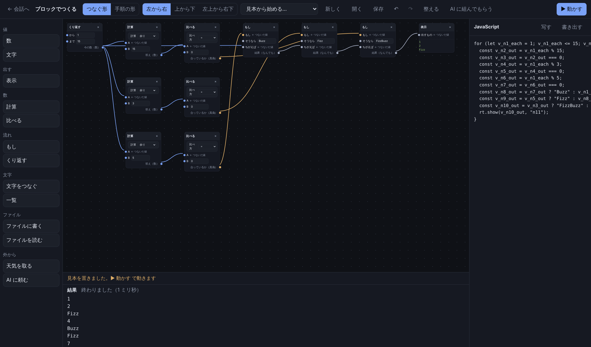

# ブロックでつくる（積み木のようにプログラムを組む画面）

初めての人でも、コードを書かずにプログラムを組めるようにする画面。ブロックを置き、出る口と入る口を線でつなぎ、
▶ 動かす を一度押すと結果が出る。同じ中身の JavaScript が横に出るので、書き方も覚えられる。

ComfyUI のようにブロックを線でつなぐ形（つなぐ形）を既定にし、Power Automate のように上から順に手順を並べる形（手順の形）も
選べる。見た目はこのアプリの色と部品で作り、どちらの製品の見た目も写さない。

## 入口

会話の画面の左上の ▦（ブロックでつくる）を押す。同じアプリのウィンドウの中で開き、← 会話へ で戻る。

| 部品 | 場所 |
|---|---|
| 画面 | `src/ui/web/blocks.html`、`blocks.js`、`blocks.css` |
| 中身（画面を持たない部分） | `src/ui/web/blocks-core.js`（試験は `test/blocks-core.test.ts`） |
| 本体の口 | `/api/blocks/direction`、`/api/blocks/weather`、`/api/blocks/ask`（`src/ui/server.ts`）。ファイルは今の `/api/file` |
| 画面を押す確かめ | `scripts/check-blocks.mjs`（id は `checks/blocks.ids`。足すだけ） |

外の部品は使わない。素の JavaScript と SVG だけで書き、組み立ての段も持たない。

## 型と色

つなぎ口には型がある。色で見分ける。

| 型 | 色の変数 | つなげる先 |
|---|---|---|
| 数 | `--port-num` | 数・文字・なんでも |
| 文字 | `--port-text` | 文字・なんでも |
| 真偽 | `--port-bool` | 真偽・文字・なんでも |
| 一覧 | `--port-list` | 一覧・なんでも |
| なんでも | `--port-any` | どこへでも |

つなげないときは線を引かず、下の帯に「つなげません: 文字は数の口にはつなげません」のようにわけを出す。
引いている途中も、置ける口は緑、置けない口は赤で縁取る。後ろのブロックから前へ戻る線（輪）も断る。
入る口は一本だけ。別の線をつなぐと前の線は外れる。入る口から引くと、つないでいた線を外して付け替えられる。

## ブロック

| まとまり | ブロック | 入る口 → 出る口 |
|---|---|---|
| 値 | 数、文字 | → 数／文字 |
| 出す | 表示 | 出すもの |
| 数 | 計算（+ − × ÷ 余り） | A, B → 答え |
| 数 | 比べる（= ≠ < ≦ > ≧） | A, B → 合っているか |
| 流れ | もし | もし, そうなら, ちがえば → 結果 |
| 流れ | くり返す | から, まで → 今の数 |
| 文字 | 文字をつなぐ | 前, 後 → 文字 |
| 文字 | 一覧 | 1, 2, 3 → 一覧 |
| ファイル | ファイルに書く | ファイル名, 中身 |
| ファイル | ファイルを読む | ファイル名 → 中身 |
| 外から | 天気を取る（今日・明日・あさって） | 場所 → 天気, 雨か |
| 外から | AI に頼む | 頼み → 答え |

つないでいない入る口は、ブロックの中の欄に値を書ける。

## 動かす

組んだ形を JavaScript にし、アプリのウィンドウの中で動かす。

- くり返すの「今の数」から辿れるブロックは、くり返しの中に入る。順はつなぎの順で、同じなら名前の順。置いた場所では決めない（向きを変えても文が変わらない）
- 表示は、下の「結果」と、そのブロックの下の両方に出る
- 落ちたら、落ちたブロックを赤く縁取り、そのブロックの下と結果に「ここで止まりました: 0 では割れません」のように出す
- 10 万歩を超えたら止める（終わらないくり返し）
- ファイルに書く前に、何をどこへ書くかを見せ、「許可」を押してから書く。AI が書くときと同じく、作業場の中だけに書き、画面の「戻す」に残る（`/api/file`）
- 天気は、会話で天気を取るのと同じ Open-Meteo の取り方（`WeatherSource`）を本体が使う。雨か は予報の言葉に 雨 か 雪 が入るか
- AI に頼むは、会話と同じモデルに頼む（`/api/blocks/ask`）。作業中は断る

右の JavaScript の欄は、組むたびに作り直す。「写す」と「書き出す」は、Node でそのまま動く形（`node 名前.mjs`）にして渡す。
天気と AI のブロックは、アプリの中でだけ動く（書き出した形では、そう言って止まる）。

AI の判断（私の推測）: 頼まれた形は「本体の、命令を動かす口で、承認の流れを通して動かす」だった。今の版では、ブロックから作った文は
アプリのウィンドウの中（ブラウザの囲いの中）で動かし、本体に触れるのはファイル・天気・AI の 3 つの口だけにした。作った文は
ブロックの種類から作るので、利用者の書いた文字は値（JSON の文字列）としてしか入らない。書き込みには承認を求める。
本体で動かす形にするのは、ブロックに「命令を動かす」を足すときに考える。

## 手順の形

上から順に手順を並べる形。いちばん上に「きっかけ」があり、その下に手順が続く。

- きっかけ: 手で動かす、毎日決まった時刻に（日本時間）、フォルダにファイルが増えたら
- 手順: ブロックと同じ種類。欄には値を書くか、「＋ 前の出力」で前の手順の出力を選ぶ（丸い札で出る）
- 条件: はい・いいえの二つに分かれ、横に並べて出す
- くり返す: 中身を字下げして出す。「今の数」は中身の手順から選べる

AI の判断（私の推測）: 毎日とファイルが増えたらは、この画面を開いている間だけ見張る（15 秒ごと）。閉じると止まる。
アプリを閉じていても動かす形は、見張る役を本体に持たせるときに考える。

つなぐ形と手順の形は、同じ中身を行き来する。

- つなぐ形 → 手順の形: いつでも変えられる（別々のくり返しの中身が混ざっているときだけ、わけを出して変えない）
- 手順の形 → つなぐ形: 条件の手順（はい・いいえ）があると変えられない。つなぐ形には分かれ道が無く、もしブロックは値を選ぶだけなので。わけを出し、手順の形のまま残す

## 向き

つなぐ形の流れる向きを、左から右（既定）・上から下・左上から右下から選ぶ。帯のボタンを一度押すか、設定の「配置」で選ぶ。
選んだ向きは設定ファイル（`blocksDirection`）に覚える。

- 出る口の場所: 左から右は右の辺、上から下は下の辺、左上から右下は下の辺の右半分。入る口はその反対
- 線の曲がり方も向きに合わせる
- 「整える」は、つなぎの深さで段を決め、向きに沿って並べ、全部が見えるように大きさを合わせる。線は必ず向きに沿って進む（`test/blocks-core.test.ts` の「向き」）
- 向きは表示だけで、組んだ中身と作る JavaScript は変わらない

手順の形は、左から右なら手順を横に、それ以外は縦に並べる。

## 保存の形

作業場に `名前.blocks.json` で置く。中身は次の形。両方の形を一つのファイルに持つ。

```json
{
  "version": 1,
  "nodes": [{ "id": "n1", "kind": "repeat", "x": 40, "y": 40, "values": { "from": 1, "to": 15 } }],
  "links": [{ "from": { "node": "n1", "port": "each" }, "to": { "node": "n2", "port": "a" } }],
  "view": "graph",
  "workflow": { "version": 1, "trigger": { "kind": "manual" }, "steps": [] }
}
```

読むときは、知らないブロックと、つなげない線を外し、何を外したかを言う。

## 手ざわり

| したいこと | やり方 |
|---|---|
| 足す | 左の一覧から引いて置く。押すと真ん中に置く。何も無い所をダブルクリックすると名前で探せる |
| 動かす（ブロック） | 頭を引く。Shift を押しながら押すと、いくつも選べる |
| 全体を動かす・大きさ | 何も無い所を引く。ホイールで大きさ |
| 消す・写す | × か Delete。Ctrl+D で写す |
| 元に戻す・やり直す | ↶ ↷、Ctrl+Z、Ctrl+Shift+Z |
| 動かす | ▶ 動かす、Ctrl+Enter |
| 保存 | 保存、Ctrl+S |
| 見本から始める | 1〜15 を数えて Fizz / Buzz、明日の天気で傘を持つか、こんにちは |

## AI に組んでもらう

「AI に組んでもらう」を押してやりたいことを書くと、保存の形の説明（`graphFormatGuide`）を添えて AI に頼み、返ってきた JSON を
読んで置く。読めない線やブロックは外して言う。

未了: 本物のモデルが、正しい形を返すかは確かめていない。会話から「〜する積み木を組んで」と頼んで、この画面に置く道もまだ無い。

## 確かめ

- `npm test` の `test/blocks-core.test.ts`: 作る JavaScript、型、保存と読み直し、手順の形との行き来、向き
- `scripts/check-blocks.mjs`: 入れた形の本体を起こし、会話の画面の ▦ から入り、空から 11 個のブロックを引いて置き、13 本の線を引いて
  FizzBuzz を組んで動かす。型の合わない線を断るか、書き出した JavaScript が Node で同じ結果を出すか、3 つの向きで同じ結果か、
  保存して開き直して同じ結果か、元に戻すか、手順の形で傘の手順を組んで予報どおりに出るか（答え合わせは Open-Meteo）を見る
- CI の `blocks`（手で回す）: setup.exe を Windows に入れて、`check-blocks.mjs` を全部回す


