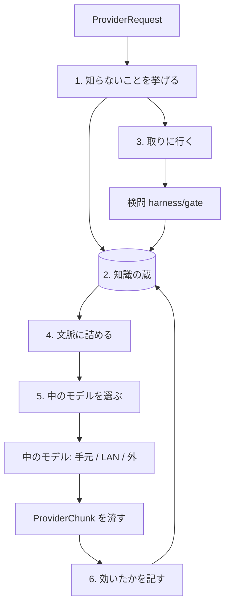

# ネットワークモデル

このツールの根幹。画面からは「ネットワーク」という1つのモデルに見えるが、重みは持たない。知識はネットワークから取って貯め、考えて書く仕事は中で別のモデルに任せる。

決めた日: 2026-10-31（DECISIONS 203）。下の「段階」の順に作る。

## なぜ

学習済みのモデルは、学習した中身でしか動けない。新しいライブラリや仕様は知らず、知らないまま自信を持って間違える。重みを学習し直すのは、手元の機械では出来ない。

そこで、知識と力を分ける。

| | どこにあるか | どう増やすか |
|---|---|---|
| 知識（API、版、仕様、エラーの意味、手順） | ネットワークと、手元の知識の蔵 | 取ってきて蔵に貯める。使って効いたものに印を付ける |
| 力（読む、考える、コードを書く、ツールを使う） | 中で使うモデルの重み | モデルを差し替える |

ネットワークモデルは、知識の側を受け持つ。力の側は、手元の GGUF でも、LAN の Ollama でも、外の API でもよい。

## 外から見た形

- `ChatProvider`（`src/providers/contract.ts`）を1つ実装する。id は `network`、モデルは `network` の1つだけ
- 送り先の候補（`src/core/registry.ts`）の先頭に置き、既定の送り先にする。画面のモデルの欄には「ネットワーク」と出る
- 呼ぶ側（`ChatOrchestrator`、`Agent`、`Session`）は何も変えない。普通のモデルと同じ口で話せる
- 中で使うモデルが1つも無くても、立ち上がりはする。そのときは「中で使うモデルがありません」と言い、推奨のモデルを取る（初回起動の自動取得、DECISIONS 202）

## 中の形

1. 知らないことを挙げる: 頼みと作業場から、「答えるのに要る事実」を短い問いの並びにする（例: `zod の最新の版`、`node:test の mock.timers の使い方`）。挙げるのは中の小さいモデルで、答えの形は JSON の型で縛る（CharacterDesigner と同じ。温度は 0）。何も要らなければ空で、そのまま 5 へ進む
2. 知識の蔵: `AAS_HOME` の下の `knowledge/` に置く。1件は「問い・答えの抜き書き・出どころの URL・取った日・版・効いた回数・外れた回数」。同じ問いで新しいもの（決めた日数以内）があれば、取りに行かない
3. 取りに行く: 既にある `fetch_url`（`src/agent/tools/network.ts`）と MCP（`src/mcp/`）を使う。行き先は許可リストで、GET だけ、資格情報は送らない。返ってきたものは検問を通し、中に紛れた指示は落とす。繋がらなければ、蔵だけで続けて「取れませんでした」と言う
4. 文脈に詰める: 蔵から引いた分を、出どころつきで要約して system に足す。小さいモデルは長い文脈で崩れるので、決めた量（`desiredContext` の一部）を超えない
5. 中のモデルを選ぶ: 今の候補選び（autopilot、`src/runtime/autopilot.ts`）をそのまま使う。頼みの重さと機械の速さで、手元 → LAN → 外の順に当てる。落ちたら次へ回す（今の orchestrator の動き）
6. 効いたかを記す: 頼みが「動かして確かめる」まで行ったら（試験・実行が通った、check-user と同じ）、使った知識の「効いた」を1つ増やす。落ちたら「外れた」を増やし、外れが多いものは次から使わない

## 守ること

- 社外に出してはいけないものを、問いとして外へ出さない。問いは事実の名前（ライブラリ名、関数名、エラーの型）だけにし、作業場のコードや頼みの本文は送らない。送る前に `redact`（`src/core/redact.ts`）を通す
- 外へ出る経路を持つ役職に write を持たせない（CLAUDE.md）。ネットワークモデルの中で取りに行く部分は、書き込みのツールを持たない
- オフラインでも動く。蔵と中のモデルだけで答え、取れなかったことを答えに添える
- 先読み（token predictor）は使わない（DECISIONS 202）

## 段階

| 段 | やること | 完成の確かめ |
|---|---|---|
| 0 | 今の成果物（Windows で作る・直す）を安定させる | Windows の `user` が 2 回続けて通る |
| 1 | 中身を持たない `network` の送り口を足し、候補の先頭に置く。中では今の候補選びにそのまま渡す（知識はまだ使わない） | `check-user` が「ネットワーク」を選んだまま通る。画面のモデルの欄に「ネットワーク」と出る |
| 2 | 知識の蔵と「知らないことを挙げる」段 | 蔵に入れた事実を、中のモデルの答えが使う試験（偽のモデルで）が通る |
| 3 | 取りに行く段（公式文書と npm の登録先だけで始める） | 偽の配布元を立てた試験で、取って、検問を通って、蔵に入る |
| 4 | 効いたかを記す | `check-user` の後、使った知識に「効いた」が付く |
| 5 | 本物で確かめる | 中のモデルが知らない新しいライブラリを使う頼みを `check-user` に足し、ネットワークだと通り、中のモデルだけだと落ちる |

## 選ばなかった案

- 重みを手元で学習し直す（LoRA など）: 手元の CPU では時間がかかりすぎ、壊れても戻しにくい
- 知識を全部、毎回取りに行く: 遅く、オフラインで止まる。蔵を挟む
- 呼ぶ側（Session や Agent）に知識の取り寄せを足す: 呼ぶ側がすべて知識の扱いを知ることになる。送り口の中に閉じ込めれば、呼ぶ側は変えずに済む
