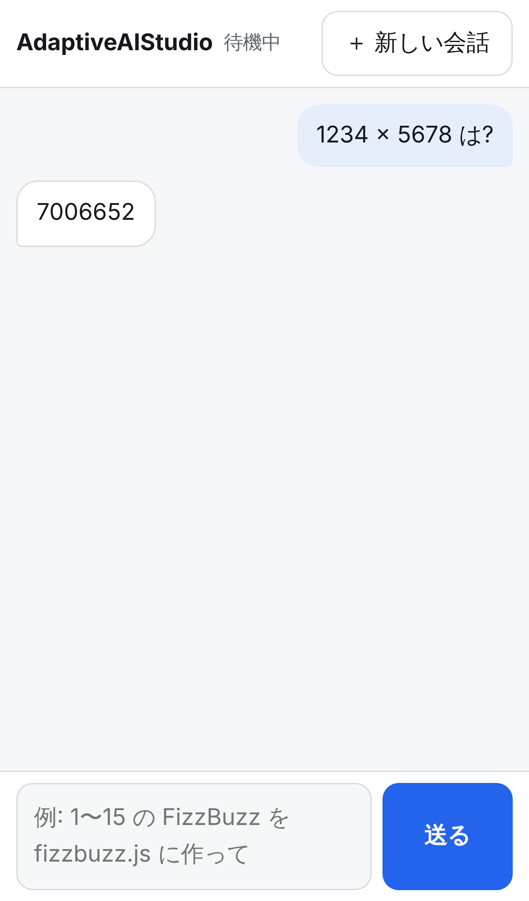

# スマホから使う

同じ Wi-Fi（家や会社の中の LAN）につないだスマホのブラウザから、PC で動いている AdaptiveAIStudio の本体に頼めます。
答えを作るのは PC の本体とモデルです。スマホは頼みを送って、答えを見るだけです。



## 使い方

1. PC のアプリのウィンドウで ⚙（設定）を押し、「スマホ」を開きます。
2. 「スマホから使う」を入れます。URL とパスフレーズと QR が出ます。
3. スマホのカメラで QR を読みます。開いた頁がそのまま繋がります（パスフレーズを打たなくて済みます）。
   QR が読めないときは、スマホのブラウザで URL を開き、パスフレーズを入れて「繋ぐ」を押します。
4. 下の欄に頼むことを書いて「送る」を押します。答えは上に流れて出ます。
   ファイルを書き換える・コマンドを動かすときの承認も、スマホで「許可」「拒否」を押せます。
5. 使い終わったら、PC の「スマホから使う」を切ります。切ると LAN には開かなくなり、スマホからは届きません。

ホーム画面に置くと、次からはアイコンを押すだけで開けます。

- iPhone（Safari）: 共有ボタン → 「ホーム画面に追加」
- Android（Chrome）: 右上の ︙ → 「ホーム画面に追加」

## 守り

- 既定では切ってあります。切っている間、本体は PC の中（127.0.0.1）にしか開いていません
- 入れても、開くのは家や会社の中だけで通じる住所（10.x・172.16〜31.x・192.168.x など）だけです。
  PC に公の住所しか無いときは開かず、設定の画面にわけが出ます。LAN の外から来た繋ぎも断ります
- パスフレーズで繋ぐと、スマホにトークン（Cookie）が渡ります。トークンの無い頼みは断ります。トークンは 30 日で切れます
- パスフレーズを間違えると、10 分のあいだに 5 回で、その住所からはしばらく受け付けなくなります
- 「パスフレーズを作り直す」を押すと、それまで繋いでいたスマホは全部繋ぎ直しになります。スマホを無くしたときは、これを押してください
- スマホからは、スマホの設定（パスフレーズを見る・切る）を変えられません。PC の画面からだけです
- 繋ぎは暗号化されていない http です。同じ Wi-Fi の中で盗み見られる心配がある場所（だれでも入れる Wi-Fi など）では使わないでください

## 分かっている制限

- http なので、多くのブラウザは service worker を動かしません。電波が無いときに画面の殻を出す働きは、そのときは効きません。
  頼みを送るには、どのみち PC の本体に届く必要があります
- iPhone の Safari では、ホーム画面に置いた形と、Safari で開いた形とで Cookie が別になります。ホーム画面に置いたら、そちらでもう一度パスフレーズで繋いでください
  （QR から開き直すか、パスフレーズを打ちます）
- iPhone では、ホーム画面に置いた形を閉じてしばらくすると、繋ぎ（答えの流れ）が切れます。開き直すと繋ぎ直します。切れている間に出た答えは、PC の画面の会話に残っています
- PC が眠ると届きません。PC の電源の設定で、使う間は眠らないようにしてください
- Windows のファイアウォールが、初めて入れたときに「アクセスを許可しますか」と聞くことがあります。「プライベート ネットワーク」を許可してください（パブリックは許可しなくて構いません）
- 繋ぎ先の住所は、Wi-Fi に繋ぎ直すと変わることがあります。変わったら、設定の画面の新しい QR を読み直してください

## 確かめ

- `test/phone.test.ts` — 住所の見分け、パスフレーズとトークン、LAN の口の関所（トークンなしは 401、違うパスフレーズは 401 で続けば 429、正しいパスフレーズでトークンが効く、切ると閉じる、公の住所には開かない）
- `test/qr.test.ts` — 組んだ QR を決まりから読み戻して、元の文字になること
- `scripts/check-phone.mjs` — 配る形の本体を起こし、PC の画面で「スマホから使う」を入れ、スマホの見立て（iPhone）でパスフレーズを入れて繋ぎ、「1234 × 5678 は?」の答えが出るまでを押して見る（CI の `phone`）。
  一度載せた確かめの id は `checks/phone.ids` にあり、消さない・飛ばさない。上の写し（`docs/images/phone-chat.png`）はこの確かめで撮ったもの

```
node scripts/check-phone.mjs --start "sh dist/AdaptiveAIStudio/app/start.sh ui" --port 4177 --shots shots
```

`--lan` を渡さないと、LAN の口を 127.0.0.2 に開けて確かめます（LAN の無い機械と CI でも回せるように）。
LAN の口から来た頼みは、住所によらずトークンを求めるので、関所の確かめとしては同じです。
