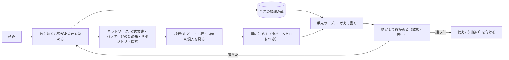

# ネットワークモデルの設計（案）

知識をモデルの重みに持たせず、毎回ネットワークから取って使う作り。取ったものは貯めて、次から使う。重みを学習し直さずに、新しい知識が身に付く形になる。

## 結論

出来る。しかも、小さいモデルを手元で動かすこの製品には向いている。ただし、分けて考えることが1つある。

- 知識（API の使い方、ライブラリの版、仕様、エラーの意味）は、ネットワークから取れる
- 力（読む・考える・コードを書く・ツールを使う）は、重みにしか無い

なので「モデルは考える役だけ、知識は全部外から」と分ける。重みを更新しなくてよいのは知識の側で、力の側はモデルを差し替えて上げる。

## 形

1. 頼みを受けたら、まず「何を知らないと解けないか」をモデルに挙げさせる（版、関数の名前、設定の書き方など）
2. 手元の蔵を先に引き、無いもの・古いものだけネットワークへ取りに行く
3. 外から返ってきたものは検問を通す（CLAUDE.md の「外から返ってきたものは検問を通す」）。出どころ、版、中に紛れた指示を見る
4. 取ったものは、出どころの URL と取った日と版を付けて蔵に貯める
5. モデルは、蔵から引いた分だけを文脈に入れて考える（全部は入れない。小さいモデルは長い文脈で崩れる）
6. 書いたものは動かして確かめる。通れば、使った知識に「効いた」と印を付ける。落ちれば、取り直すか別の出どころを当たる

これで、使うほど蔵が育つ。重みは変わらないが、次の同じ種類の頼みは速く正しくなる。

## 既にあるもの

- 外のツールを MCP で繋ぐ口（`src/mcp/`）。検索や文書の取得は MCP の相手として足せる
- 外から返ってきたものの検問、外へ出る経路を持つ役職に write を持たせない決まり
- 覚え（memory）の仕組み。蔵の下地にできる
- 動かして確かめる流れ（このところ足した check-user も同じ考え）

## 足すもの

- 頼みから「知らないこと」を挙げる段
- 蔵（出どころ・日付・版・効いたかの印つき）と、古くなったら取り直す決まり
- 取りに行く先の並び（公式文書、npm や PyPI の登録先、GitHub、検索）
- オフラインのときは蔵だけで答え、そう言う

## 限りと危うさ

- 力は増えない。小さいモデルは、正しい資料を渡されても使いこなせないことがある。力が足りなければモデルを差し替える
- 遅くなる。取りに行くたびに数秒から数十秒かかる。蔵に当たれば速い
- ネットの中身は嘘も古い情報も混ざる。出どころを選び、動かして確かめるのが前提
- 外の文書に指示が仕込まれていることがある。検問を通さずに、モデルへ直接渡さない
- 社外に出してはいけないコードや頼みを、検索の言葉として外へ送らない決まりが要る

## 進め方（案）

1. 先に Windows で作る・直すを安定させる（今の成果物）
2. 蔵と「知らないことを挙げる段」を入れ、公式文書と npm の登録先だけで始める
3. check-user に「手元のモデルが知らない新しいライブラリを使う頼み」を足し、蔵があると通る・無いと落ちる、を確かめる
